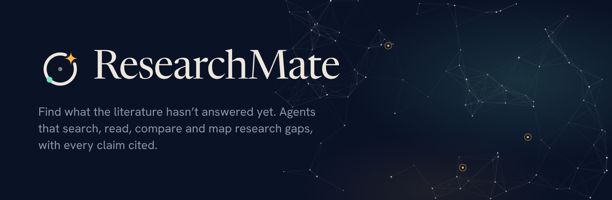
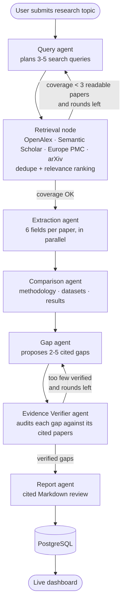
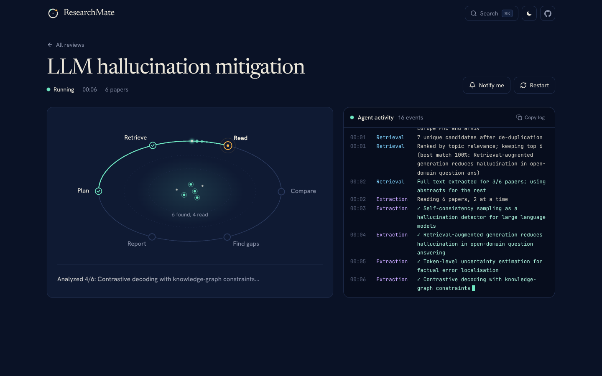
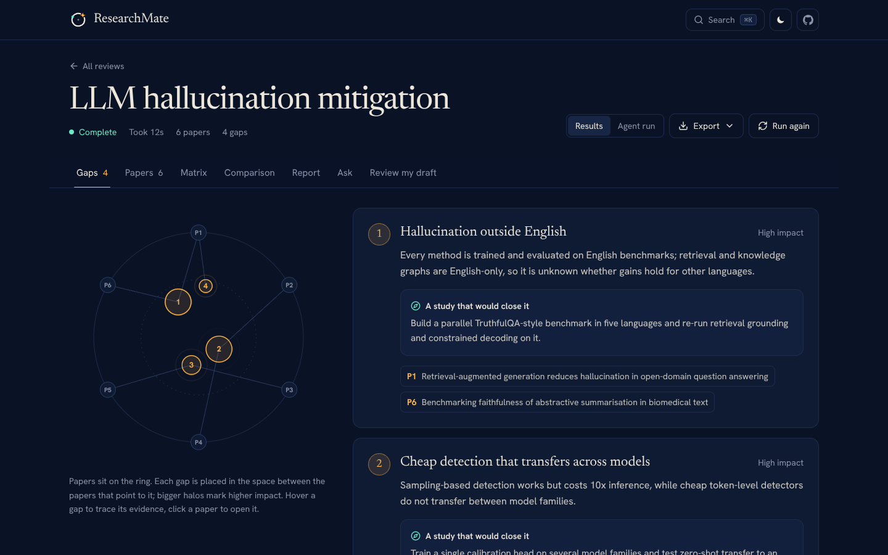

<div align="center">



### **Autonomous Agentic AI Literature Review & Gap Synthesis Platform**

[](https://fastapi.tiangolo.com)
[](https://nextjs.org)
[](https://langchain-ai.github.io/langgraph/)
[](https://ai.google.dev/)
[](https://www.postgresql.org)
[](https://www.docker.com)
[](LICENSE)

*An autonomous end-to-end multi-agent system that searches live academic repositories, downloads and analyzes full-text PDFs, extracts structured scientific dimensions, maps cross-paper comparisons, synthesizes citation-backed research gaps, and drafts publication-ready executive reports.*

---

</div>

## 📌 Executive Overview

Traditional literature reviews require researchers to manually screen hundreds of abstracts, download disparate PDFs, normalize methodologies, and deduce overlooked limitations. 

**ResearchMate** automates this lifecycle with a **LangGraph multi-agent graph** of seven nodes and two feedback loops. It combines four live scholarly APIs (**OpenAlex**, **Semantic Scholar**, **Europe PMC** and **arXiv**), PDF extraction with reference-section stripping, and **Google Gemini** reasoning (with Gemma fallbacks), and delivers:

1. **Deep Paper Acquisition**: Autonomous search query expansion retrieving real open-access academic literature.
2. **Reference-Stripped PDF Ingestion**: PyMuPDF extraction discarding terminal bibliographies to conserve LLM context windows.
3. **6-Dimensional Structured Analysis**: Automated extraction of Problem, Methodology, Dataset, Results, Limitations, and Future Work.
4. **Comparative Matrix Synthesis**: Cross-paper evaluation across methodologies, benchmark datasets, and empirical performance.
5. **Evidence-Backed Research Gaps**: Discovery of unexplored directions linked directly to supporting citations.
6. **Executive Synthesis Report**: Polished Markdown literature report with instant 1-click export and download.

---

## 🏛️ System Architecture

The pipeline is a LangGraph `StateGraph` running asynchronously behind FastAPI. Two conditional edges turn it from a
straight chain into a graph whose agents can send work back:



---

## ⚡ Agent Graph Breakdown

| Node | Kind | What it does | Output |
| :--- | :--- | :--- | :--- |
| **Query** | LLM agent | Breaks the topic into 3–5 search angles. On the coverage loop it receives Retrieval's feedback and the queries already tried, and re-plans broader ones. | Search queries |
| **Retrieval** | Tool node + decision | Searches 4 scholarly APIs in parallel, de-duplicates by DOI/title, ranks by relevance, fetches open-access PDFs (PyMuPDF). **Decides** whether coverage is sufficient; if not, routes back to Query. | Ranked, stored paper set |
| **Extraction** | LLM agent (fan-out) | Reads each paper concurrently and extracts Problem, Methodology, Dataset, Results, Limitations, Future Work as strict JSON. Writes "Not reported" instead of guessing. | Structured analyses |
| **Comparison** | LLM agent (fan-out) | Writes cited cross-paper synthesis on methodology, datasets and results. | 3 comparison write-ups |
| **Gaps** | LLM agent | Proposes 2–5 gaps from recurring limitations, each citing `[P#]` papers. On the verification loop it receives the Verifier's rejection reasons. | Candidate gaps |
| **Verifier** | LLM agent + rules | Independently audits every candidate: rejects gaps citing no paper, asks the model whether the cited papers really state the limitation, and narrows evidence to confirmed papers. Sends the Gap agent back if fewer than 2 gaps survive. | Verified, stored gaps |
| **Report** | LLM agent | Writes the cited literature review in GitHub-flavoured Markdown. | Report |

Loop limits are configurable: `RESEARCHMATE_MIN_PAPERS` (3), `RESEARCHMATE_MAX_SEARCH_ROUNDS` (2),
`RESEARCHMATE_MIN_GAPS` (2), `RESEARCHMATE_MAX_GAP_ROUNDS` (2).

---

## 🖥️ Web Interface

<p align="center"></p>
<p align="center"></p>
<p align="center"><sub>Screenshots use sample data.</sub></p>

- **Live agent run** — the seven pipeline stages sit on an orbit; the progress arc, active station and paper "stars" update as each one works, beside a streaming log of real agent events (queries issued, coverage re-plans, papers ranked, PDFs read, gaps proposed, verified or rejected, failures).
- **Gap map** — papers on a ring, each research gap placed between the papers that evidence it, sized by impact. Hover to trace the evidence, click to open a paper.
- **Citations everywhere** — every `[P3]` the agents write becomes a clickable chip that shows the paper title and jumps to it.
- **Papers** — ranked by topic relevance, marked *full text* or *abstract only*, with the six extracted fields and links to the PDF, DOI and the exact text the agent read.
- **Matrix** — all papers against problem, method, data, results, limitations and future work in one grid; CSV export.
- **Comparison** and **Report** — readable serif layout, report table of contents, Markdown download, print-to-PDF.
- **Ask** — chat with the corpus. Answers come only from the review's papers, with citations, and say so when the papers don't cover a question.
- **Review my draft** — paste text or drop a PDF for a referee-style critique against the papers and gaps: score, revision checklist, papers you should cite.
- **Export** — Markdown report, PDF, BibTeX (`.bib`) for LaTeX, or everything as JSON.
- **⌘K command palette**, number keys `1`–`7` for tabs, undo on delete, browser notification when a long run finishes, light and dark themes, works down to phone width, respects reduced motion.

---

## 🚀 Quick Start Guide

### Prerequisites
- **Python 3.10+**
- **Node.js 18+** & **npm**
- **PostgreSQL 14+** (or Docker)
- **Google Gemini API Key** ([Get a key](https://aistudio.google.com/app/apikey))

---

### Option 1: Docker Compose (All-in-One)

```bash
# 1. Clone repository
git clone https://github.com/shreyans-chowdry/research_mate.git
cd research_mate

# 2. Configure environment
cp backend/.env.example backend/.env
# Add your GOOGLE_API_KEY in backend/.env

# 3. Launch PostgreSQL, Backend, and Frontend containers
docker compose up --build
```
The application will be accessible at:
- Frontend: `http://localhost:3000`
- Backend API Docs: `http://localhost:8000/docs`

---

### Option 2: Local Development Setup

#### 1. Backend Setup
```bash
# Navigate to workspace
cd ResearchMate

# Create and activate virtual environment
python3 -m venv venv
source venv/bin/activate

# Install backend dependencies
pip install -r backend/requirements.txt

# Configure environment
cp backend/.env.example backend/.env
# Set DATABASE_URL and GOOGLE_API_KEY in backend/.env

# Initialize database schema & run verification
python3 backend/db/test_db.py

# Start FastAPI development server
uvicorn backend.api.main:app --reload --port 8000
```

#### 2. Frontend Setup
```bash
# In a new terminal
cd ResearchMate/frontend

# Install dependencies
npm install

# Start Next.js development server
npm run dev
```
Open [http://localhost:3000](http://localhost:3000) in your browser.

---

## 📡 REST API Reference

All backend endpoints follow a clean RESTful specification:

| Method | Endpoint | Description |
| :--- | :--- | :--- |
| `POST` | `/api/research` | Initialize a new research project and dispatch autonomous pipeline |
| `GET` | `/api/research/{id}/status?since_event=N` | Poll status, paper counts, and agent activity events newer than `N` |
| `GET` | `/api/research/{id}/papers` | Retrieve all acquired papers and their 6-dimension analyses |
| `GET` | `/api/research/{id}/comparison` | Fetch cross-paper comparative dimensions |
| `GET` | `/api/research/{id}/gaps` | Fetch synthesized research gaps with supporting evidence trails |
| `GET` | `/api/research/{id}/report` | Fetch final Markdown executive synthesis report |
| `POST` | `/api/research/{id}/retry` | Clear the previous run's results and run the pipeline again |
| `POST` | `/api/research/{id}/ask` | Ask a question answered only from this project's papers, with `[P#]` citations |
| `POST` | `/api/research/{id}/critique-paper` | Referee-style review of a pasted draft (PDF: `/critique-paper-upload`) |
| `DELETE` | `/api/research/{id}` | Delete a project and everything attached to it |
| `GET` | `/health` | Health check endpoint |

---

## 🧪 Testing & Verification

The offline suite runs the real LangGraph pipeline, FastAPI routes and PostgreSQL with the search APIs and Gemini replaced by deterministic fakes, so it needs no API keys or network access. It covers ranking, retry without duplicates, no invented evidence, tolerance of a failed paper, the Ask and critique endpoints, and that slow LLM calls don't block the server.

```bash
# Offline agent pipeline tests (no keys needed; also run in CI)
python -m pytest backend/tests -q
```

The scripts below call the live APIs and need a `GOOGLE_API_KEY`:

```bash
# Test 1: Database Connection & DDL Schema
python3 backend/db/test_db.py

# Test 2: Academic Search & PDF Processing Pipeline
python3 backend/pipeline/test_pipeline.py

# Test 3: LangGraph Multi-Agent Orchestrator
python3 backend/api/agents/test_agents.py

# Test 4: FastAPI REST Endpoints
python3 backend/api/test_api.py

# Test 5: Full End-to-End Autonomous Pipeline
python3 backend/test_run.py

# Test 6: Frontend Production Build
npm --prefix frontend run build
```

---

## ⚙️ Tuning

| Variable | Default | What it controls |
| :--- | :--- | :--- |
| `GEMINI_MODEL` | `gemini-3-flash-preview` | Primary model (Gemma models are used as fallbacks) |
| `RESEARCHMATE_MAX_PAPERS` | `6` | Papers analysed per review after relevance ranking |
| `RESEARCHMATE_MAX_PDFS` | `4` | Open-access PDFs downloaded for full-text reading |
| `RESEARCHMATE_LLM_CONCURRENCY` | `2` | Parallel LLM calls (keep low on the free tier) |
| `PDF_TIMEOUT_SECONDS` | `15` | Per-PDF download timeout |

---

## 📄 License

Distributed under the MIT License. See [LICENSE](LICENSE) for more details.
